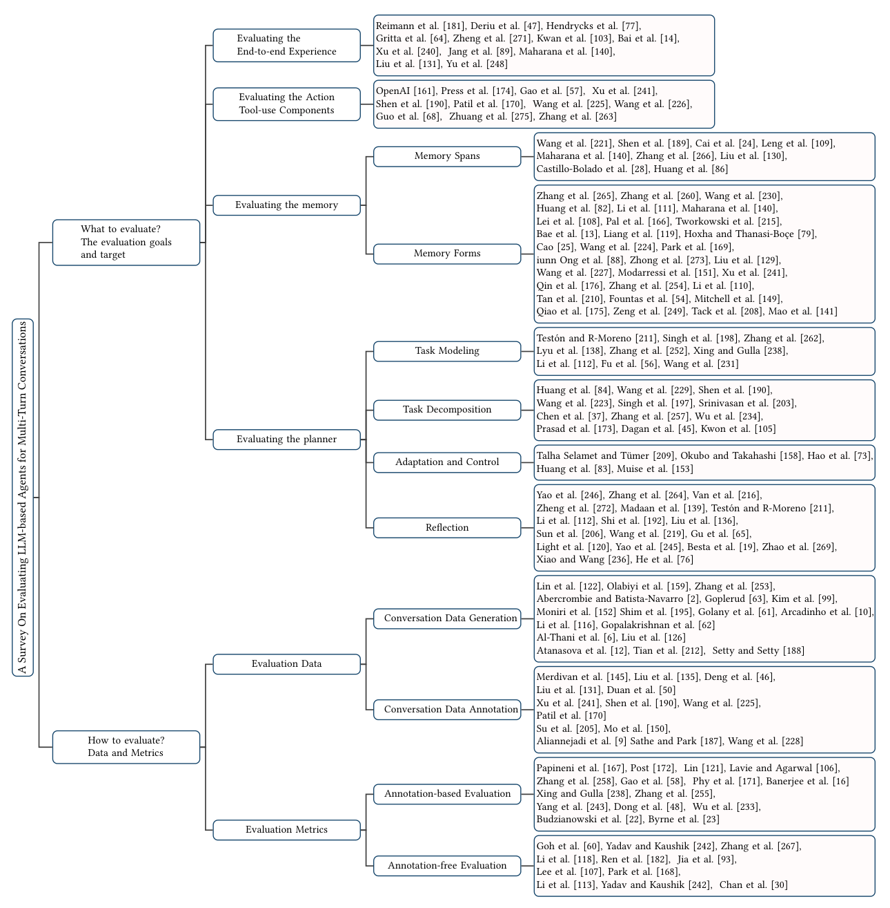
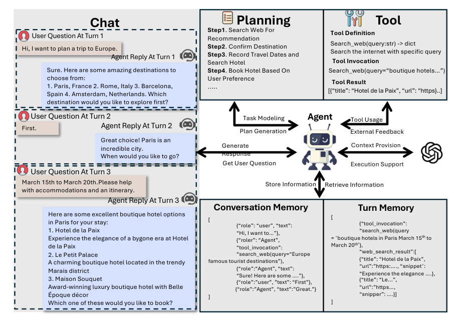
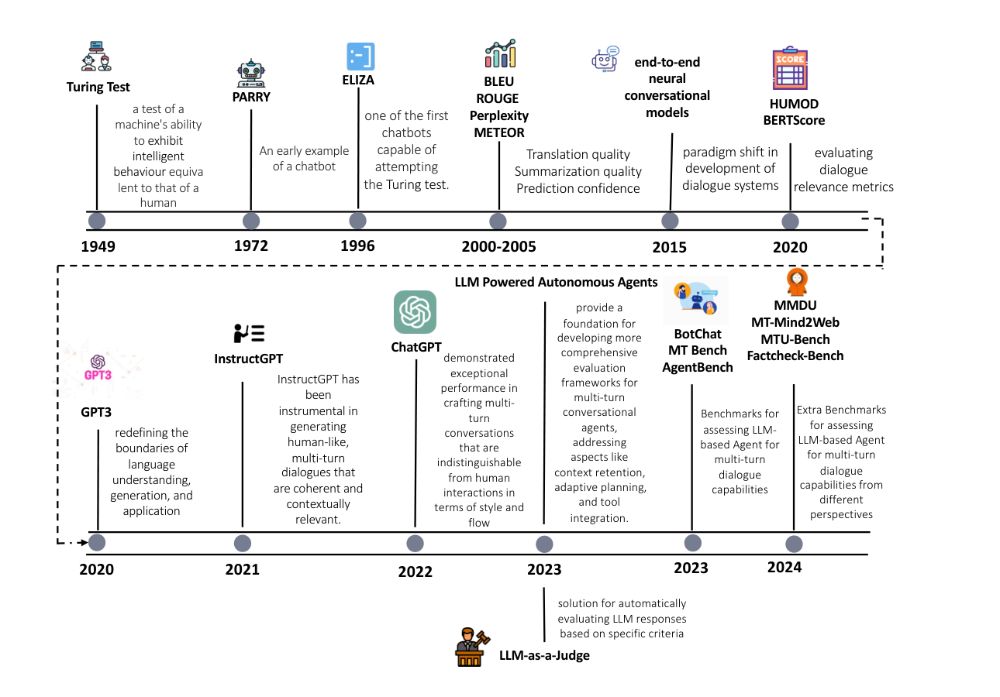

# 大语言模型多轮对话智能体评测综述

[English](README.md) · [论文](https://arxiv.org/abs/2503.22458) · [PDF](https://arxiv.org/pdf/2503.22458)

本仓库是 **Evaluating LLM-based Agents for Multi-Turn Conversations: A Survey** 的配套资料仓库。

作者：Shengyue Guan、Jindong Wang、Jiang Bian、Bin Zhu、Jian-guang Lou、Haoyi Xiong。

## 从哪里开始

论文围绕两个问题组织多轮对话智能体评测：**评什么**与**怎么评**。

| 评测对象 | 主要关注点 |
| --- | --- |
| 端到端体验 | 任务完成、交互模式、用户体验与安全 |
| 动作与工具使用 | API 交互、多步骤工具选择、可靠性与幻觉 |
| 记忆 | 单轮、会话和持久记忆，以及记忆表示形式 |
| 规划 | 任务建模、任务分解、适应与控制、反思 |

评测方法涵盖对话数据生成与标注、依赖参考答案的指标、无标注评测，以及大模型裁判。

## 核心框架

多轮评测要同时考察整段对话的结果，以及工具、记忆和规划如何支撑任务完成。单轮回答正确，仍可能在后续对话中遗忘约束、误解工具输出或沿用失效计划。

论文的主要贡献是将“评什么”和“怎么评”连接起来：从端到端体验、动作与工具、记忆、规划四个对象出发，对应数据生成与标注、有标注与无标注评测方法。

## 智能体交互示例

## 演进路线

## 主要结论与研究方向

- 结合单轮和整段对话评测，追踪上下文变化与错误传播。
- 区分短期记忆、会话记忆和持久记忆，关注跨会话一致性。
- 评估连续工具调用与动态规划，结合中间执行证据判断结果。
- 在自动化评测中兼顾规模、裁判可靠性、偏差与成本。
- 推进实时自评、自我纠错、隐私保护与伦理评测。

## 资料导航

- [核心内容导读](docs/key-insights.md)：主要贡献、评测维度、方法与开放问题（英文）。
- [全部 10 张原图](docs/figures.md)：含原始图注及 PDF 页码。
- [评测方法对比](docs/evaluation-methods.md)：论文表 1 与评分示例。
- [论文 PDF](paper/2503.22458v2.pdf)：仓库内保存的 arXiv v2。

- [分类导读](docs/taxonomy.md)：对应论文第二、三章的结构。
- [基准与资源表](docs/benchmarks.md)：整理论文第三章的研究、评测目标与指标。
- [完整参考文献](docs/references.md)：从 arXiv v2 HTML 提取的 267 条文献均附来源地址，点击标题可直达论文；两条历史文献使用对应图书出版页或作者目录，并注明情况。
- [参与贡献](CONTRIBUTING.md)：通过 Issue 或 Pull Request 提交勘误和资源建议。

初始资料版本对应 **2026 年 1 月 5 日发布的 arXiv v2**。引用格式见 [英文 README](README.md#citation)。文档及论文改编内容采用 [CC BY 4.0](LICENSE)；所链接资源遵循各自许可。
