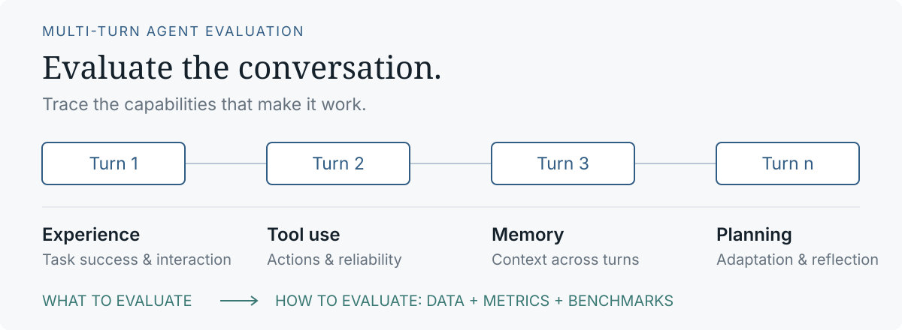
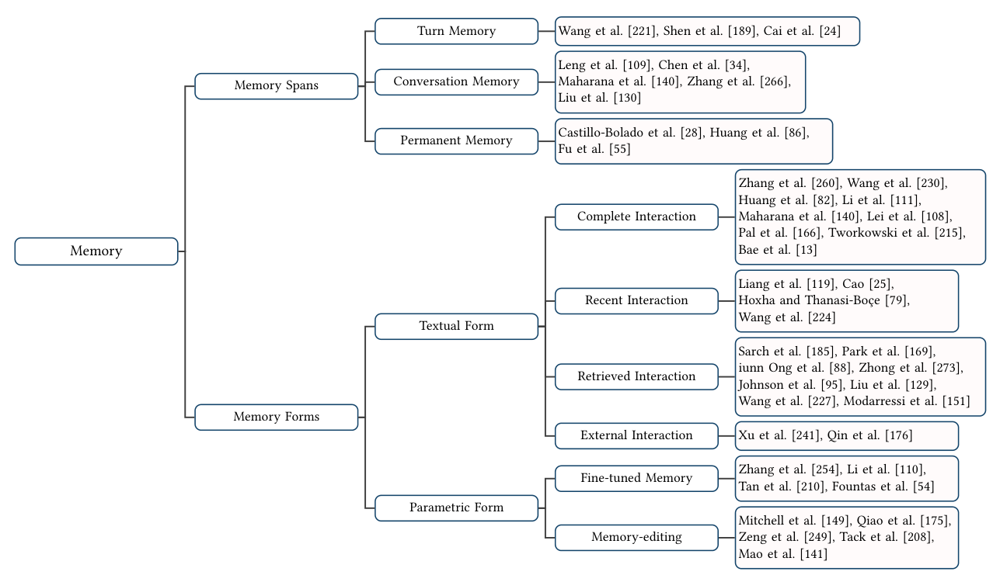
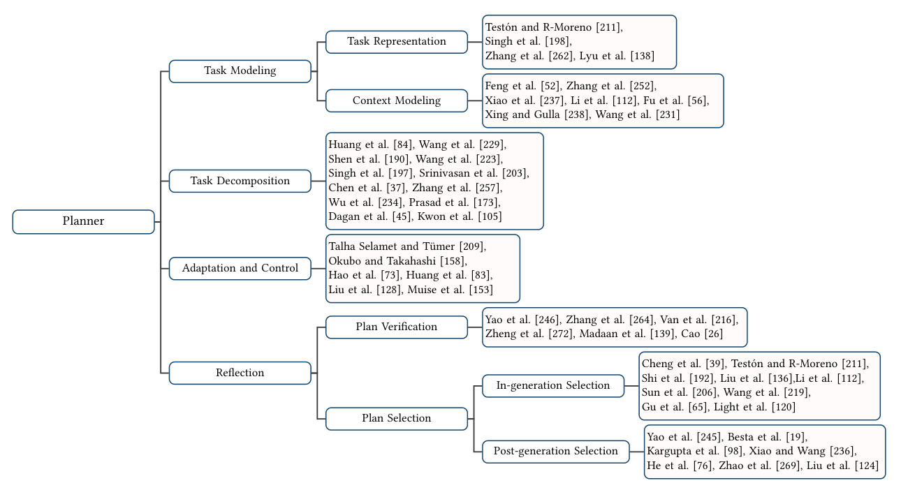
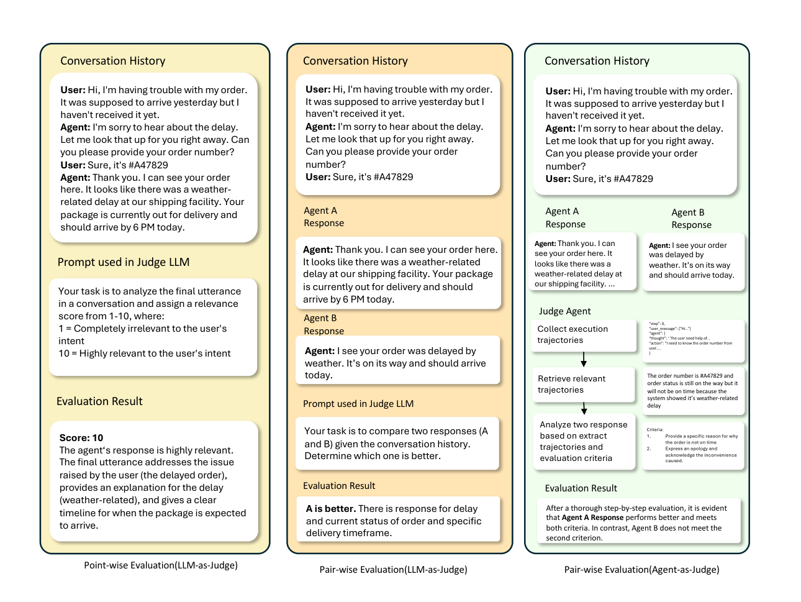

<p align="right"><a href="README.md">English</a> · <strong>简体中文</strong></p>

# 大语言模型多轮对话智能体评测综述

### A Survey · ACM TIST 2026

**从对话、工具、记忆与规划出发，梳理多轮对话智能体“评什么”与“怎么评”。**

Shengyue Guan · Jindong Wang · Jiang Bian · Bin Zhu · Jian-Guang Lou · Haoyi Xiong

[](https://doi.org/10.1145/3793671)
[](https://arxiv.org/abs/2503.22458)
[](LICENSE)

[**阅读正式论文 ↗**](https://doi.org/10.1145/3793671) · [核心导读](docs/key-insights.md) · [评测基准](docs/benchmarks.md) · [参考文献](docs/references.md) · [引用](#引用)

<p align="center">
  
</p>

## 从这里开始

本仓库是 **Evaluating LLM-based Agents for Multi-turn Conversations: A Survey** 的配套资料库。论文已发表于 *ACM Transactions on Intelligent Systems and Technology*，2026 年第 17 卷第 4 期。

- **理解论文框架：**阅读[核心内容与主要结论](docs/key-insights.md)（英文）。
- **寻找评测资源：**浏览[基准表](docs/benchmarks.md)和[评测方法对比](docs/evaluation-methods.md)。
- **查阅相关研究：**打开含论文链接的 [267 条参考文献索引](docs/references.md)。
- **查看原始材料：**阅读[全部 10 张原图](docs/figures.md)或 [arXiv v2 论文 PDF](paper/2503.22458v2.pdf)。

## 评什么

整段对话能否成功，取决于端到端体验，以及工具、记忆、规划三个组件在连续交互中的表现。

| 评测对象 | 核心问题 |
| --- | --- |
| **端到端体验** | 能否完成任务，并保持连贯、有用、安全的交互？ |
| **动作与工具使用** | 能否跨轮次正确选择、串联工具，并理解执行结果？ |
| **记忆** | 能否在单轮、会话和跨会话场景中保留并使用相关信息？ |
| **规划** | 能否建模目标、分解任务、调整计划并反思决策？ |

### 论文完整分类体系 · 图 3


[查看大图](assets/figures/fig-03-evaluation-taxonomy.png) · [按论文章节阅读](docs/taxonomy.md)


### 跨轮次的记忆评测 · 图 4



记忆评测同时关注**信息保留多久**，以及**如何表示与检索信息**。[完整原图与图注](docs/figures.md#figure-4-memory-taxonomy)。

### 规划与动态适应 · 图 6



规划评测覆盖任务建模、任务分解、适应与控制、反思四个方面。[完整原图与图注](docs/figures.md#figure-6-planner-taxonomy)。

## 怎么评

第二套分类将**评测数据**与**评测指标**连接起来：

1. **构建数据：**生成或标注回答、工具调用、改写查询、检索信息和事实声明。
2. **选择方法：**使用参考答案、精确匹配、独立评分、成对或列表比较，以及 LLM／智能体裁判。
3. **观察过程：**结合中间动作、记忆使用和计划调整，理解最终任务结果。

[比较评测方法 →](docs/evaluation-methods.md) · [浏览评测基准 →](docs/benchmarks.md)

### 独立评分与成对比较 · 图 9



独立评分根据给定标准评价一个回答；成对比较直接判断两个候选回答的相对表现。[原始示例与图注](docs/figures.md#figure-9-pointwise-pairwise)。

## 多轮对话智能体如何协作


示例展示了用户需求逐步展开时，规划、工具执行和记忆如何共同支持对话。[查看原始图注与来源](docs/figures.md#figure-1-agent-example)。

## 开放问题与研究方向

论文讨论了跨轮次自适应评测、长期记忆基准、实时自评、错误纠正、连续工具使用、规模化评测、隐私保护和伦理责任。

### 对话系统与评测方法的演进路线 · 图 10


[查看完整路线图与图注](docs/figures.md#figure-10-roadmap)


[阅读开放问题与未来方向 →](docs/key-insights.md#open-challenges-and-future-directions)

## 引用

请引用 ACM TIST 正式发表版本。[DOI](https://doi.org/10.1145/3793671) · [BibTeX 文件](citation.bib)

```bibtex
@article{guan2026evaluating,
  title = {Evaluating {LLM}-based Agents for Multi-turn Conversations: A Survey},
  author = {Guan, Shengyue and Wang, Jindong and Bian, Jiang and Zhu, Bin and Lou, Jian-Guang and Xiong, Haoyi},
  journal = {ACM Transactions on Intelligent Systems and Technology},
  volume = {17},
  number = {4},
  pages = {1--40},
  year = {2026},
  month = apr,
  publisher = {Association for Computing Machinery},
  doi = {10.1145/3793671},
  url = {https://doi.org/10.1145/3793671}
}
```

## 版本、贡献与许可

资料集对应 **2026 年 1 月 5 日的 arXiv v2**，引用信息指向 ACM 正式版。仓库内 PDF 和提取的原图保留 arXiv v2 内容。[文献链接说明](docs/references.md#link-notes)注明了两条使用图书出版页或作者目录的历史文献。

欢迎通过 Issue 或 Pull Request 提交资源建议与勘误，见[贡献说明](CONTRIBUTING.md)。

文档及 arXiv 改编材料采用 [CC BY 4.0](LICENSE)。首页概览图是依据论文分类绘制的简化示意图；带编号的图片来自论文原文。外部资源遵循各自许可。
