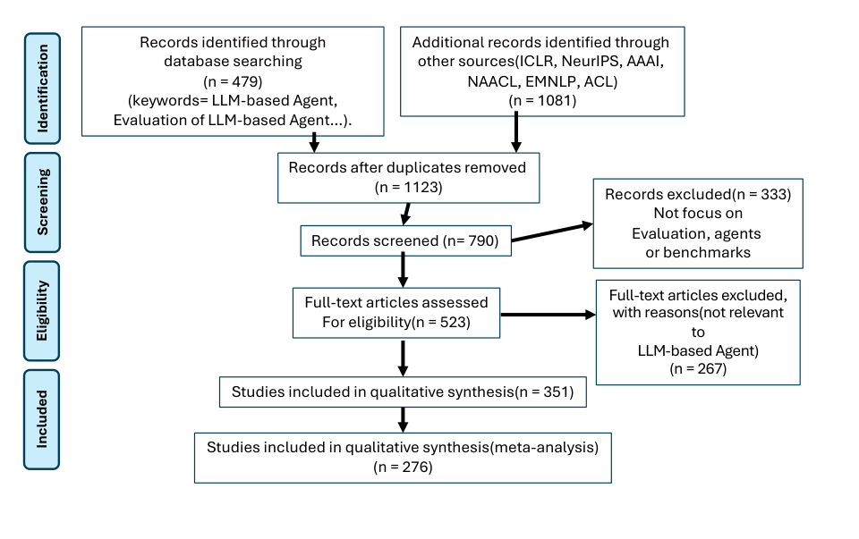
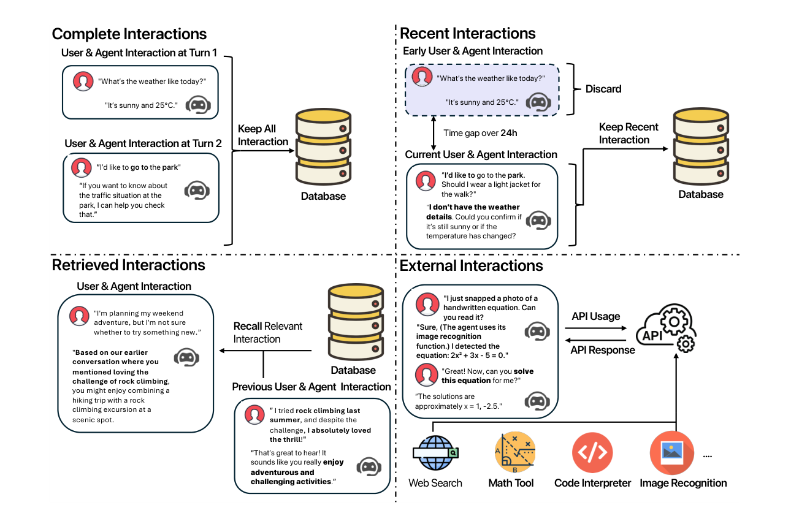
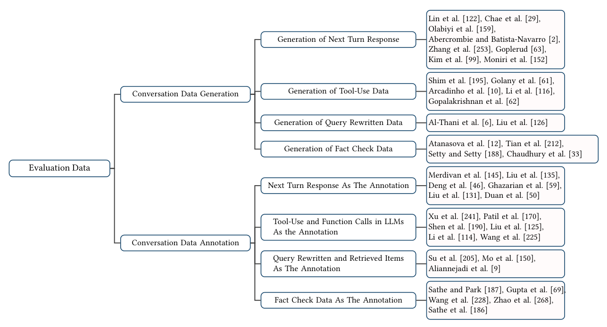
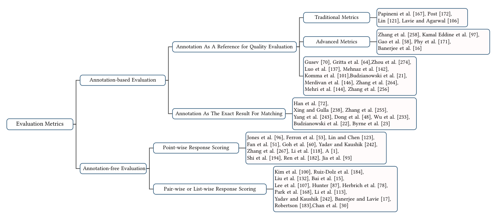

# Figures from the paper

All 10 figures from [arXiv v2](https://arxiv.org/abs/2503.22458v2), rendered from the published PDF at 3× resolution. Figure artwork is unchanged; page text and captions are excluded from the image crops. Captions and PDF page numbers appear below.

## Figure 1: Agent Example

Figure 1. An example of Multi-turn Conversational Agents based on LLMs

PDF page 2.

## Figure 2: Paper Selection

Figure 2. Selection Process for Papers Evaluating LLM-based Agents in Multi-turn Conversations

PDF page 3.

## Figure 3: Evaluation Taxonomy

Figure 3. Taxonomy of Evaluation Approaches for LLM-Based Multi-Turn Conversational Agents: A Comprehensive Survey of Goals, Methodologies, and Future Directions.

PDF page 4.

## Figure 4: Memory Taxonomy

Figure 4. Taxonomy of Evaluation Memory of LLM-Based Agents in Multi-Turn Conversations.

PDF page 9.

## Figure 5: Memory Forms

Figure 5. Four Types of User-Agent Interactions ( Zhang et al., 2024g ) : Complete Interactions : This refers to the database storing all interactions between the user and the agent. Every conversation or action is captured and retained for future reference; Recent Interactions :In this case, if the user asks for weather details and the time gap exceeds 24 hours, the information is discarded.; Retrieved Interactions : This occurs when the agent recalls past interactions. External Interactions : In this scenario, the user uploads an image, and the agent uses image recognition to analyze the content. The agent might then use a math tool to solve an equation that is written on the image.

PDF page 11.

## Figure 6: Planner Taxonomy

Figure 6. Taxonomy of Evaluation Planner of LLM-Based Agents in Multi-Turn Conversations.

PDF page 12.

## Figure 7: Evaluation Data

Figure 7. Taxonomy of Evaluation Data for LLM-based Agents in Multi-Turn Conversations.

PDF page 15.

## Figure 8: Evaluation Metrics

Figure 8. Taxonomy of Evaluation Metrics for LLM-based Agents in Multi-Turn Conversations.

PDF page 16.

## Figure 9: Pointwise Pairwise

Figure 9. An Example of Point-wise and Pair-wise Evaluation

PDF page 18.

## Figure 10: Roadmap

Figure 10. A Roadmap of Evaluation of LLM-based Agents for Multi-turn Conversation. The blue line represents the development of metrics and benchmark for Multi-turn Conversation. The orange line represents the development of Multi-turn Conversation

PDF page 22.

## Attribution

Shengyue Guan, Jindong Wang, Jiang Bian, Bin Zhu, Jian-guang Lou, and Haoyi Xiong. *Evaluating LLM-based Agents for Multi-Turn Conversations: A Survey*. arXiv:2503.22458v2. [CC BY 4.0](https://creativecommons.org/licenses/by/4.0/). Figure 5 includes attribution to Zhang et al. (2024g), as in the paper.
